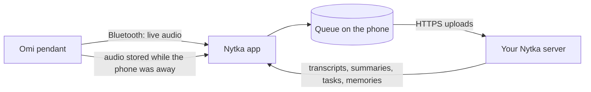

<!-- readme:header:start -->
<p>
  
  <a href="https://github.com/nytka-app/android/actions/workflows/ci.yml"></a>
  
</p>
<!-- readme:header:end -->

# Nytka for Android

> An Android app for the Omi AI pendant that sends its audio to your own Nytka server instead of Omi's cloud.

<!-- readme:status:start -->
**Active**. I work on it this month.
<!-- readme:status:end -->



## Why

The Omi pendant records all day, and its official app sends that audio to Omi's cloud, with Omi's models and a
free tier of 300 minutes and 30 questions a month. I wanted the recordings of my life on a server I run, with the
transcription and language models I choose and no quota. [Nytka](https://github.com/nytka-app/server) is that
server; this app is its phone half. [How Nytka compares](docs/explanation/comparison.md) has the side-by-side.

## What it does

- **Captures the pendant over Bluetooth** and keeps every frame in a queue on the phone until the server has it:
  up to 1 GiB, about 60 hours offline. Mute with a double tap on the pendant, bookmark with a single tap.
- **Copies what the pendant stored while the phone was away** (firmware 3.0.20 or later), with the times it was
  said, and frees the pendant's storage only after the server accepted the audio.
  [Offline sync](docs/explanation/offline-sync.md) explains it.
- **Shows what the server makes of it:** conversations with titles, summaries and transcripts, tasks, memories,
  people and their voices, search, and Ask, a question answered from your conversations with numbered sources.
- **Puts what matters first** on a server that supports it: **Today** (at most seven things: what matters and what
  you owe or are owed, never anything private), the **Timeline** of the day's scenes, and **Over time** (patterns that unlock as days add up). Every
  item opens the lines it came from and plays from that moment; mark it not important, not yours, or someone
  else's in place; a tap on the pendant marks a moment as vital. Each item and conversation shows **Earlier** moments
  about the same thing, tags and people get **topic pages**, and Over time sums up each week, month, year and all
  time. [The screens](docs/reference/screens.md#today-timeline-and-over-time).
- **Can transcribe on the phone too** (Google Play build, off by default): free, private and offline draft text
  from a model you copy to the phone yourself, made only while it charges unless you allow battery use.
  [Transcribe on this phone](docs/reference/device.md#transcribe-on-this-phone).
- **Runs the server from the phone:** its settings, access tokens and webhooks, plus the pendant's LED brightness
  and microphone gain (the gain in effect is sent with the audio's times; the app never changes it by itself).
- **Tells the server what the phone was doing**, so it can tell a television or a call from a conversation:
  speaker playback, calls, the screen and headphones, as times only. Activity (walking, driving, still) and the kind
  of app that plays are separate switches, off by default; no app name, title or artist leaves the phone.
  [Phone context](docs/reference/device.md#phone-context).
- **Can record with the phone's own microphone** (off by default, only while you keep it on): for days without the
  pendant. An ongoing notification shows while it records, it is off again after a restart, and its audio reaches
  the server as its own source, never mixed into the pendant's conversations.
  [Phone microphone](docs/reference/device.md#phone-microphone).
- **Talks to your server and nothing else**, apart from a once-a-day firmware check against GitHub that you can
  switch off. No analytics, no crash reporting, no Omi cloud. [What stays on the phone](docs/explanation/privacy.md).

Not here: iOS, raw audio export, firmware updates (the official Omi app does those). The app asks for
`RECORD_AUDIO` only when you switch Phone microphone on.

> [!WARNING]
> The pendant records the people around you, and keeps recording to its own memory while the phone is away.
> Recording people without their consent is illegal in some places; you answer for following the law where you
> use it.

> [!WARNING]
> Phone microphone mode records everyone near the phone, not only near the pendant, and the phone often lies on a
> table between people. In Ukraine, recording someone's private conversation without consent can fall under Criminal
> Code art. 182 and Civil Code art. 306 ([codes](https://zakon.rada.gov.ua/laws/show/2341-14)); keeping recordings for
> yourself is outside the data-protection law ([art. 25](https://zakon.rada.gov.ua/laws/show/2297-17)), and the GDPR's
> household exemption is read narrowly. Turn it on only where the people around you know. This is not legal advice.

## Quick start

You need a phone on Android 12 or later, an Omi pendant on firmware 3.0.x, and a Nytka server with an `admin`
token ([server install](https://github.com/nytka-app/server/blob/main/docs/how-to/install.md#install-in-15-minutes), about 15 minutes). Download
`nytka-<version>.apk` from [Releases](https://github.com/nytka-app/android/releases/latest) and open it on the
phone, or build it yourself with JDK 21 and the Android SDK (platform 37):

```bash
git clone https://github.com/nytka-app/android.git && cd android
./gradlew assembleOssDebug
adb install app/build/outputs/apk/oss/debug/app-oss-debug.apk
```

Uninstall the official Omi app first: two apps cannot hold the pendant at once. The first run takes about five
minutes: server address and token (or scan the server's QR code), two permissions, a consent screen, pairing.
[Get started](docs/tutorial.md) walks through it, and covers [Obtainium](https://github.com/ImranR98/Obtainium)
for automatic updates.

## How it works

The app has three modules. `:pendant` speaks the pendant's Bluetooth protocol and reassembles its Opus audio
frames; `:core` holds the queue (a Room database), the upload format shared with the server, and the server
clients; `:app` is the Compose UI and the background services. Four rules hold everywhere:

- **A frame is safe once it is in the queue.** Each live frame is written as it arrives; stored frames from the
  pendant are written in one transaction with the pendant's read position.
- **Nothing is deleted before the server answers.** Only a `200` or `202` removes audio from the queue, and the
  pendant's copy is freed only past what the server accepted, a mute dropped or you chose to discard.
- **HTTPS is enforced in code.** Plain `http://` works only with the private-network switch on, for a server on a
  VPN.
- **Nothing sensitive in logs:** no audio, transcript, token or server address in log events or the debug report.

## Numbers

| | Value | Source |
|---|---|---|
| Unit tests | 1,241 `@Test` methods | `grep -rho '@Test' */src/test`, commit `5f775c3` |
| App code | 31,690 lines of Kotlin | `src/main` of all modules, same commit |
| Releases | 23, from v0.1.0 on 2026-09-29 to v0.20.0 | `git tag` |
| Users | 1, me | counted |

## Docs

- [Get started](docs/tutorial.md): what you need, install, the first run
- [The screens](docs/reference/screens.md): every tab, search, appearance, tags
- [The Device screen](docs/reference/device.md): pendant, its settings and firmware notice, your voice, phone microphone, phone
  context, meeting briefs, location tags, transcribe on this phone
- [Everyday use](docs/how-to/everyday-use.md) · [When something is off](docs/how-to/troubleshooting.md)
- [Offline sync](docs/explanation/offline-sync.md) · [What stays on the phone](docs/explanation/privacy.md) ·
  [How Nytka compares](docs/explanation/comparison.md)
- [Developer mode](docs/reference/developer-mode.md): measurements, server settings, tokens, webhooks
- [Build from source](docs/how-to/build-from-source.md) · [Contributing](CONTRIBUTING.md) ·
  [F-Droid draft](docs/fdroid/README.md)
- Specs and plans: [people](docs/specs/people.md), [speech kind](docs/specs/speech-kind.md),
  [tags](docs/specs/tags.md), [plans](docs/plans/); what each version must do is in the
  [server's specs](https://github.com/nytka-app/server/tree/main/docs/specs)

Nytka is an independent project, not affiliated with or endorsed by Based Hardware; "Omi" is a trademark of its
owner. Apache-2.0, see [LICENSE](LICENSE) and [NOTICE](NOTICE).
