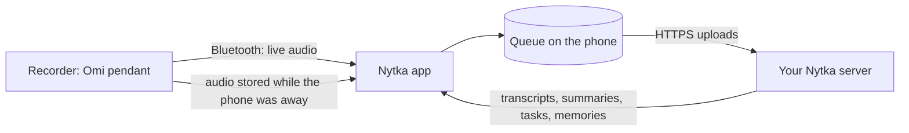

<!-- readme:header:start -->
<p>
  
  <a href="https://github.com/nytka-app/android/actions/workflows/ci.yml"></a>
  
</p>
<!-- readme:header:end -->

# Nytka for Android

> An Android app for wearable AI recorders (the Omi pendant today) that sends their audio to your own Nytka server instead of the maker's cloud, and shows what the server makes of it.

<!-- readme:status:start -->
**Active**. I work on it this month.
<!-- readme:status:end -->



## Why

The Omi pendant records all day, and its official app sends that audio to Omi's cloud, with Omi's models and a
free tier of 300 minutes and 30 questions a month. I wanted the recordings of my life on a server I run, with the
transcription and language models I choose and no quota. [Nytka](https://github.com/nytka-app/server) is that
server; this app is its phone half. [How Nytka compares](docs/explanation/comparison.md) has the side-by-side.

## What it does

- **Captures the recorder over Bluetooth** and keeps every frame in a queue on the phone until the server has it:
  up to 1 GiB, about 60 hours offline. Mute with a double tap on the pendant, bookmark with a single tap.
- **Copies what the recorder stored while the phone was away** (Omi pendant, firmware 3.0.20 or later), with the
  times it was said, and frees the recorder's storage only after the server accepted the audio.
  [Offline sync](docs/explanation/offline-sync.md) explains it.
- **Shows what the server makes of it:** conversations with titles, summaries and transcripts, tasks, memories,
  people and their voices, search, and Ask, a question answered from your conversations with numbered sources.
  **Forget this person** (with an admin token) removes the person, their facts, voiceprints, tags and topic page and
  everything built only from their lines; the conversations and other people's lines stay.
- **Puts what matters first** on a server that supports it: **Today** (at most seven things: what matters and what
  you owe or are owed, never anything private), the **Timeline** of the day's scenes, and **Over time** (patterns
  that unlock as days add up). Every item opens the lines it came from and plays from that moment; mark it not
  important, not yours, or someone else's in place. [The screens](docs/reference/screens.md#today-timeline-and-over-time).
- **Can transcribe on the phone too** (Google Play build, off by default): free, private and offline draft text
  from a model you copy to the phone yourself, made only while it charges unless you allow battery use.
  [Transcribe on this phone](docs/reference/device.md#transcribe-on-this-phone).
- **Runs the server from the phone:** its settings, access tokens and webhooks, plus the pendant's LED brightness
  and microphone gain (the gain in effect is sent with the audio's times; the app never changes it by itself).
- **Tells the server what the phone was doing**, so it can tell a television or a call from a conversation:
  speaker playback, calls, the screen and headphones, as times only. Activity (walking, driving, still) and the kind
  of app that plays are separate switches, off by default; no app name, title or artist leaves the phone.
  [Phone context](docs/reference/device.md#phone-context).
- **Can record with the phone's own microphone** (off by default, only while you keep it on): for days without the
  pendant. An ongoing notification shows while it records, it is off again after a restart, and its audio reaches
  the server as its own source, never mixed into the pendant's conversations.
  [Phone microphone](docs/reference/device.md#phone-microphone).
- **Shows the server's nudges as notifications** (on by default): a commitment due within a day, the evening recap,
  an unlocked insight, a day unlike your usual. One notification per nudge, and the lock screen shows no text.
  [Nudges](docs/reference/device.md#nudges).
- **Talks to your server and nothing else**, apart from a once-a-day firmware check against GitHub that you can
  switch off. No analytics, no crash reporting, no Omi cloud. [What stays on the phone](docs/explanation/privacy.md).

Not here: iOS, raw audio export, firmware updates (the official Omi app does those). The app asks for
`RECORD_AUDIO` only when you switch Phone microphone on.

> [!WARNING]
> The pendant records the people around you, and keeps recording to its own memory while the phone is away.
> Recording people without their consent is illegal in some places; you answer for following the law where you
> use it.

> [!WARNING]
> Phone microphone mode records everyone near the phone, not only near the pendant, and the phone often lies on a
> table between people. In Ukraine, recording someone's private conversation without consent can fall under Criminal
> Code art. 182 and Civil Code art. 306 ([codes](https://zakon.rada.gov.ua/laws/show/2341-14)); keeping recordings for
> yourself is outside the data-protection law ([art. 25](https://zakon.rada.gov.ua/laws/show/2297-17)), and the GDPR's
> household exemption is read narrowly. Turn it on only where the people around you know. This is not legal advice.

## Recorders

| Recorder | Status | Live audio | Stored audio while the phone is away | Mute | Bookmark | Settings |
|---|---|---|---|---|---|---|
| Omi pendant (firmware 3.0.x) | **Supported**, in daily use | yes | yes, from firmware 3.0.20 | double tap | single tap | LED, microphone gain |
| Limitless Pendant | Pairable, still **not verified on real hardware** | yes | yes, copied from its flash and freed only after the server accepted it | double press | not available | LED |

Any other recorder has no driver. A recorder that cannot hand over stored audio loses what is said while the phone is
away. Pairing, what to uninstall first and what each model can do: [Recorders](docs/devices.md).

**Limitless is unproven.** Its driver is written from the source of `BasedHardware/omi` (commit `afad3b7`, MIT) and
tested only against `FakeLimitless`, a stand-in that answers the way that source reads; no Limitless pendant has been
in reach. The pairing screen offers it as a second choice next to Omi (Omi stays the default), with the words "Not
verified on real hardware" once you pick it. If you own one and want to be its first tester, open an issue. Known
gaps, all from what the source does not say:

- The size of a flash page is unknown, so the transfer rate shown while copying is an estimate.
- The pendant's own clock is not compared with the phone's, so times of stored audio are the pendant's.
- Whether the pendant records to its flash while it streams live, and whether it accepts a free command outside a
  copy, is unknown. If it does not record to flash, audio said while the phone is away is lost.
- No haptic, no firmware notice, and the app cannot tell a stalled live stream from a quiet room.

## Quick start

You need a phone on Android 12 or later, an Omi pendant on firmware 3.0.x, and a Nytka server with an `admin`
token ([server install](https://github.com/nytka-app/server/blob/main/docs/how-to/install.md#install-in-15-minutes), about 15 minutes). Download
`nytka-<version>.apk` from [Releases](https://github.com/nytka-app/android/releases/latest) and open it on the
phone, or build it yourself with JDK 21 and the Android SDK (platform 37):

```bash
git clone https://github.com/nytka-app/android.git && cd android
./gradlew assembleOssDebug
adb install app/build/outputs/apk/oss/debug/app-oss-debug.apk
```

Uninstall the maker's app first (for the Omi pendant, the official Omi app): two apps cannot hold the recorder at once. The first run takes about five
minutes: server address and token (or scan the server's QR code), two permissions, a consent screen, pairing.
[Get started](docs/tutorial.md) walks through it.

## Install without Google Play

The APK on [Releases](https://github.com/nytka-app/android/releases) is the `oss` build: it has no Google Play
services, so it runs on a phone without them. Each release has one file, `nytka-<version>.apk`, signed with the
project's key.

- **Obtainium** installs it and offers every new release: tap **Add app**, paste
  `https://github.com/nytka-app/android` and tap **Add**. [Details](docs/tutorial.md#install-with-obtainium).
- **IzzyOnDroid** reads the same APK from Releases. Nytka is not listed there yet; the
  [request](docs/fdroid/izzyondroid-request.md) is drafted and not sent.
- **F-Droid** builds apps from source. Nytka is not on F-Droid yet; the [draft](docs/fdroid/README.md) is not sent.

To check what you downloaded, `apksigner verify --print-certs nytka-<version>.apk` prints the signing
certificate, which stays the same from release to release; Android refuses an update signed with another key.

## How it works

The app has three modules. `:pendant` holds one driver per recorder model (Omi and Limitless) behind one `Pendant`
interface with its `Capabilities`, and reassembles the Opus audio frames; `:core` holds the queue (a Room database),
the upload format shared with the server, and the server clients; `:app` is the Compose UI and the background
services. Four rules hold everywhere:

- **A frame is safe once it is in the queue.** Each live frame is written as it arrives; stored frames from the
  recorder are written in one transaction with its read position.
- **Nothing is deleted before the server answers.** Only a `200` or `202` removes audio from the queue, and the
  recorder's copy is freed only past what the server accepted, a mute dropped or you chose to discard. The app also
  records only from a recorder whose audio format the server lists.
- **HTTPS is enforced in code.** Plain `http://` works only with the private-network switch on, for a server on a
  VPN.
- **Nothing sensitive in logs:** no audio, transcript, token or server address in log events or the debug report.

## Accessibility

Home, Timeline, Conversations, Tasks, People, Ask, Memories, the tab bar, Device with its settings and the capture status are checked on every change for
TalkBack names and roles, 48 dp touch targets, text at 130% and 200% font size without clipping, and WCAG AA contrast
of the theme in light and dark. The checks run on the JVM; nobody has yet gone through the app on a phone with
TalkBack, and the other screens (Over time and the rest) are not covered yet. What is checked and what is not:
[accessibility spec](docs/specs/accessibility.md).

## Numbers

| | Value | Source |
|---|---|---|
| Unit tests | 1,558 `@Test` methods | `grep -rho '@Test' --include='*.kt'` over the `src/test` folders of `core`, `pendant` and `app`, commit `7e52e9f` |
| App code | 42,429 lines of Kotlin | `src/main` of all modules, same commit |
| Releases | 32 tags, from v0.1.0 on 2026-09-29 to v0.26.3 | `git tag` |
| Users | 1, me | counted |

## Docs

- [Get started](docs/tutorial.md): what you need, install, the first run
- [The screens](docs/reference/screens.md): every tab, search, appearance, tags
- [Recorders](docs/devices.md): which recorders work, what each can do, what you do first
- [The Device screen](docs/reference/device.md): pendant, its settings and firmware notice, your voice, phone microphone, phone
  context, nudges, meeting briefs, location tags, transcribe on this phone
- [Everyday use](docs/how-to/everyday-use.md) · [When something is off](docs/how-to/troubleshooting.md)
- [Offline sync](docs/explanation/offline-sync.md) · [What stays on the phone](docs/explanation/privacy.md) ·
  [How Nytka compares](docs/explanation/comparison.md) · [Why the link drops](docs/explanation/link-drops.md)
- [Developer mode](docs/reference/developer-mode.md): measurements, server settings, tokens, webhooks
- [Build from source](docs/how-to/build-from-source.md) · [Contributing](CONTRIBUTING.md) ·
  [F-Droid, IzzyOnDroid, Obtainium](docs/fdroid/README.md)
- Specs and plans: [people](docs/specs/people.md), [speech kind](docs/specs/speech-kind.md),
  [tags](docs/specs/tags.md), [accessibility](docs/specs/accessibility.md), [plans](docs/plans/); what each
  version must do is in the [server's specs](https://github.com/nytka-app/server/tree/main/docs/specs)

Nytka is an independent project, not affiliated with or endorsed by Based Hardware or any other recorder maker;
"Omi" is a trademark of Based Hardware, and "Limitless", "Plaud", "Fieldy", "Friend" and "Bee" belong to their owners. Apache-2.0, see [LICENSE](LICENSE) and [NOTICE](NOTICE).
